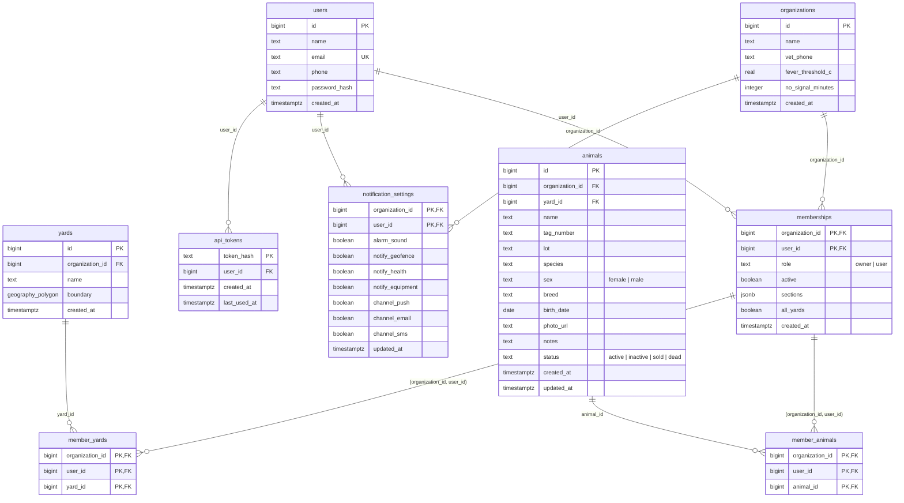
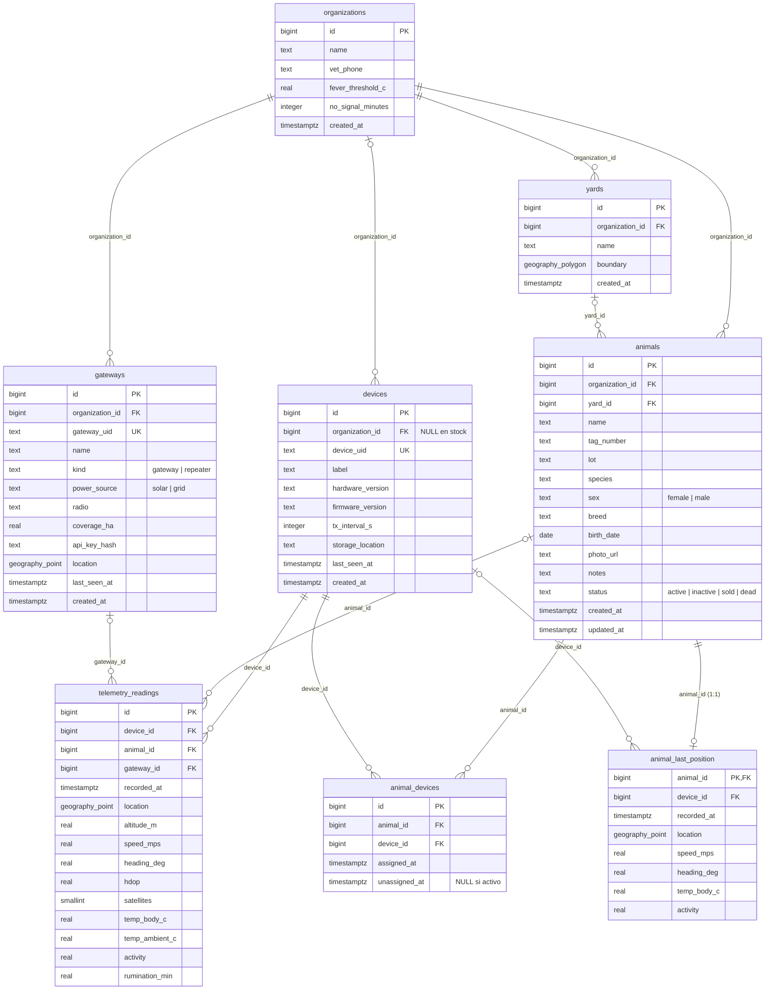
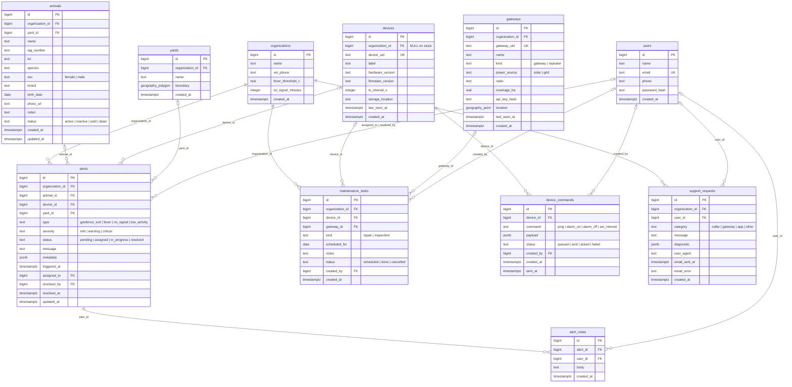

# Diagrama Entidad-Relación (DER) — MooPing

Este documento presenta el **Diagrama Entidad-Relación (DER)** completo de las **19 tablas** definidas en [`schema.sql`](../db/schema.sql), seguido de vistas separadas por módulo (con todos los atributos de cada entidad) para facilitar su lectura.

---

## 1. DER Completo (Todas las tablas)

```mermaid
erDiagram
    organizations {
        bigint id PK
        text name
        text vet_phone
        real fever_threshold_c
        integer no_signal_minutes
        timestamptz created_at
    }

    users {
        bigint id PK
        text name
        text email UK
        text phone
        text password_hash
        timestamptz created_at
    }

    memberships {
        bigint organization_id PK,FK
        bigint user_id PK,FK
        text role "owner | user"
        boolean active
        jsonb sections
        boolean all_yards
        timestamptz created_at
    }

    api_tokens {
        text token_hash PK
        bigint user_id FK
        timestamptz created_at
        timestamptz last_used_at
    }

    notification_settings {
        bigint organization_id PK,FK
        bigint user_id PK,FK
        boolean alarm_sound
        boolean notify_geofence
        boolean notify_health
        boolean notify_equipment
        boolean channel_push
        boolean channel_email
        boolean channel_sms
        timestamptz updated_at
    }

    gateways {
        bigint id PK
        bigint organization_id FK
        text gateway_uid UK
        text name
        text kind "gateway | repeater"
        text power_source "solar | grid"
        text radio
        real coverage_ha
        text api_key_hash
        geography_point location
        timestamptz last_seen_at
        timestamptz created_at
    }

    yards {
        bigint id PK
        bigint organization_id FK
        text name
        geography_polygon boundary
        timestamptz created_at
    }

    devices {
        bigint id PK
        bigint organization_id FK "NULL en stock"
        text device_uid UK
        text label
        text hardware_version
        text firmware_version
        integer tx_interval_s
        text storage_location
        timestamptz last_seen_at
        timestamptz created_at
    }

    animals {
        bigint id PK
        bigint organization_id FK
        bigint yard_id FK
        text name
        text tag_number
        text lot
        text species
        text sex "female | male"
        text breed
        date birth_date
        text photo_url
        text notes
        text status "active | inactive | sold | dead"
        timestamptz created_at
        timestamptz updated_at
    }

    animal_devices {
        bigint id PK
        bigint animal_id FK
        bigint device_id FK
        timestamptz assigned_at
        timestamptz unassigned_at "NULL si activo"
    }

    member_yards {
        bigint organization_id PK,FK
        bigint user_id PK,FK
        bigint yard_id PK,FK
    }

    member_animals {
        bigint organization_id PK,FK
        bigint user_id PK,FK
        bigint animal_id PK,FK
    }

    telemetry_readings {
        bigint id PK
        bigint device_id FK
        bigint animal_id FK
        bigint gateway_id FK
        timestamptz recorded_at
        geography_point location
        real altitude_m
        real speed_mps
        real heading_deg
        real hdop
        smallint satellites
        real temp_body_c
        real temp_ambient_c
        real activity
        real rumination_min
    }

    animal_last_position {
        bigint animal_id PK,FK
        bigint device_id FK
        timestamptz recorded_at
        geography_point location
        real speed_mps
        real heading_deg
        real temp_body_c
        real activity
    }

    alerts {
        bigint id PK
        bigint organization_id FK
        bigint animal_id FK
        bigint device_id FK
        bigint yard_id FK
        text type "geofence_exit | fever | no_signal | low_activity"
        text severity "info | warning | critical"
        text status "pending | assigned | in_progress | resolved"
        text message
        jsonb metadata
        timestamptz triggered_at
        bigint assigned_to FK
        bigint resolved_by FK
        timestamptz resolved_at
        timestamptz updated_at
    }

    alert_notes {
        bigint id PK
        bigint alert_id FK
        bigint user_id FK
        text body
        timestamptz created_at
    }

    maintenance_tasks {
        bigint id PK
        bigint organization_id FK
        bigint device_id FK
        bigint gateway_id FK
        text kind "repair | inspection"
        date scheduled_for
        text notes
        text status "scheduled | done | cancelled"
        bigint created_by FK
        timestamptz created_at
    }

    support_requests {
        bigint id PK
        bigint organization_id FK
        bigint user_id FK
        text category "collar | gateway | app | other"
        text message
        jsonb diagnostic
        text user_agent
        timestamptz email_sent_at
        text email_error
        timestamptz created_at
    }

    device_commands {
        bigint id PK
        bigint device_id FK
        text command "ping | alarm_on | alarm_off | set_interval"
        jsonb payload
        text status "queued | sent | acked | failed"
        bigint created_by FK
        timestamptz created_at
        timestamptz sent_at
    }

    %% Relaciones: Organizaciones, Usuarios y Permisos
    organizations ||--o{ memberships : "tiene miembros"
    users ||--o{ memberships : "pertenece a"
    users ||--o{ api_tokens : "autentica con"
    organizations ||--o{ notification_settings : "configura"
    users ||--o{ notification_settings : "prefiere"
    memberships ||--o{ member_yards : "restringe a potreros"
    yards ||--o{ member_yards : "visible por miembro"
    memberships ||--o{ member_animals : "restringe a animales"
    animals ||--o{ member_animals : "visible por miembro"

    %% Relaciones: Infraestructura y Animales
    organizations ||--o{ gateways : "posee"
    organizations ||--o{ yards : "divide en"
    organizations |o--o{ devices : "asigna stock"
    organizations ||--o{ animals : "posee"
    yards |o--o{ animals : "aloja"
    animals ||--o{ animal_devices : "usa historial"
    devices ||--o{ animal_devices : "asignado en historial"

    %% Relaciones: Telemetría
    devices ||--o{ telemetry_readings : "emite"
    animals |o--o{ telemetry_readings : "registra lectura"
    gateways |o--o{ telemetry_readings : "recibe"
    animals ||--o| animal_last_position : "última posición"
    devices |o--o{ animal_last_position : "reportada por"

    %% Relaciones: Alertas y Operaciones
    organizations ||--o{ alerts : "registra"
    animals |o--o{ alerts : "genera"
    devices |o--o{ alerts : "involucra collar"
    yards |o--o{ alerts : "involucra potrero"
    users |o--o{ alerts : "assigned_to / resolved_by"
    alerts ||--o{ alert_notes : "tiene notas"
    users |o--o{ alert_notes : "escribe"

    organizations ||--o{ maintenance_tasks : "programa"
    devices |o--o{ maintenance_tasks : "mantiene collar"
    gateways |o--o{ maintenance_tasks : "mantiene estación"
    users |o--o{ maintenance_tasks : "crea tarea"

    organizations ||--o{ support_requests : "reporta en"
    users |o--o{ support_requests : "envía reclamo"

    devices ||--o{ device_commands : "recibe comando"
    users |o--o{ device_commands : "envía comando"
```

---

## 2. Vistas por Módulo (con todos los atributos)

### Módulo A: Organizaciones, Usuarios y Permisos
Modela los establecimientos (`organizations`), usuarios (`users`), membresías N:M (`memberships`) y el alcance granular de permisos por potrero (`member_yards`) y por animal (`member_animals`) cuando `all_yards = false`.

---

### Módulo B: Infraestructura de Campo, Animales y Telemetría
Modela potreros (`yards`), estaciones LoRa (`gateways`), collares (`devices`), animales (`animals`), el historial de colocación de collares (`animal_devices`) y el flujo de lecturas (`telemetry_readings`) hacia la última posición conocida (`animal_last_position`).

---

### Módulo C: Alertas, Mantenimiento, Comandos y Soporte
Modela el ciclo de vida de alertas (`alerts` y `alert_notes`), tareas de campo (`maintenance_tasks`), comandos downlink a collares (`device_commands`) y tickets de soporte (`support_requests`).

---

## 3. Reglas de Integridad y Cardinalidades Especiales

| Relación / Tabla | Regla en Base de Datos |
| :--- | :--- |
| **[`animal_devices`](../db/schema.sql)** | Es un historial **N:M** entre `animals` y `devices`, pero restringido a **1:1 activo** mediante dos índices únicos parciales (`WHERE unassigned_at IS NULL`) sobre `animal_id` y `device_id`. |
| **[`member_yards`](../db/schema.sql) / [`member_animals`](../db/schema.sql)** | Tienen clave foránea compuesta `(organization_id, user_id)` apuntando a [`memberships`](../db/schema.sql) con `ON DELETE CASCADE`. |
| **[`animal_last_position`](../db/schema.sql)** | Relación **1:0..1** con `animals` (`animal_id` es tanto `PRIMARY KEY` como `FOREIGN KEY`), mantenida automáticamente por el trigger `telemetry_after_insert()`. |
| **[`maintenance_tasks`](../db/schema.sql)** | Arco inclusivo (`CHECK (device_id IS NOT NULL OR gateway_id IS NOT NULL)`): toda tarea de mantenimiento debe referenciar al menos un collar o una estación receptora. |
| **[`devices.organization_id`](../db/schema.sql)** | Es la única entidad de negocio cuya FK a `organizations` acepta `NULL` (`ON DELETE SET NULL`), representando collares que están en el stock de fábrica sin asignar a un establecimiento. |
