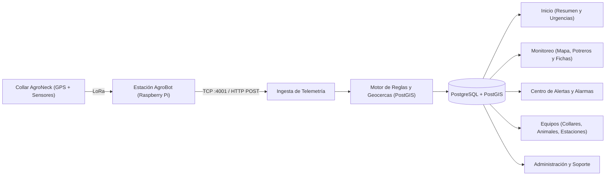

# Especificación de Requerimientos Funcionales — MooPing (AgroNomad)

Este documento detalla todos los **requerimientos funcionales (RF)** que cumple actualmente la aplicación **MooPing** ([`frontend`](../frontend/src/App.jsx) y [`backend`](../backend/api/traffic/urls.py)), la plataforma web de monitoreo inteligente de ganado del ecosistema **AgroNomad** (collares **AgroNeck** + estaciones receptoras LoRa **AgroBot**).

---

## 1. Actores y Roles del Sistema

La aplicación opera bajo un esquema multi-establecimiento (*multi-tenant* por organización) con dos roles principales definidos en [`memberships`](../db/schema.sql):

| Actor / Rol | Identificador | Capacidades Principales |
| :--- | :--- | :--- |
| **Dueño del establecimiento** | `owner` (*Dueño*) | Acceso total sin restricciones de alcance ni de secciones. Puede crear, editar y eliminar potreros, animales, collares, estaciones y usuarios; configurar umbrales del establecimiento; enviar comandos a collares y gestionar permisos. |
| **Personal de campo** | `user` (*Usuario*) | Acceso de lectura condicionado por los permisos asignados por el dueño (secciones habilitadas y alcance de potreros/animales). Puede atender alertas, tomar alertas a su cargo, registrar notas en alertas, configurar sus preferencias de aviso, cambiar su contraseña y enviar reclamos de soporte. |
| **Estación Receptora (AgroBot)** | Sistema externo (TCP / HTTP) | Envía paquetes JSON de telemetría provenientes de los collares **AgroNeck** mediante el servicio receptor TCP ([`telemetry_tcp.py`](../backend/api/management/commands/telemetry_tcp.py)) o vía API REST (`POST /api/telemetry/`). |

---

## 2. Resumen de Módulos y Flujo Operativo

---

## 3. Catálogo de Requerimientos Funcionales

### 3.1. Autenticación, Sesiones y Cuenta Personal (`RF-AUT`)

* **RF-AUT-01 — Inicio de sesión con credenciales:** El sistema debe permitir a un usuario autenticarse con email y contraseña (`POST /api/auth/login/`), emitiendo una sesión mediante cookie `HttpOnly` (`mooping_session`) con validez configurable (30 días por defecto) y almacenando en base de datos únicamente el hash SHA-256 del token ([`Login.jsx`](../frontend/src/pages/Login.jsx), [`ENDPOINTS.md`](../backend/ENDPOINTS.md)).
* **RF-AUT-02 — Limitación de intentos de inicio de sesión (*Rate Limiting*):** El sistema debe bloquear temporalmente los intentos de inicio de sesión cuando superen el límite por dirección IP (`10/min` por defecto) o por cuenta de correo (`20/hora` por defecto), respondiendo con código `429` y tiempo de espera (`Retry-After`).
* **RF-AUT-03 — Cierre de sesión:** El sistema debe permitir al usuario cerrar su sesión actual (`POST /api/auth/logout/`), eliminando el token activo en el servidor y limpiando la cookie de sesión.
* **RF-AUT-04 — Consulta de perfil y membresías:** El sistema debe proveer los datos del usuario autenticado (nombre, email, teléfono, iniciales) junto con los establecimientos a los que pertenece, su rol y las secciones habilitadas (`GET /api/me/`, [`HeaderMenus.jsx`](../frontend/src/components/HeaderMenus.jsx)).
* **RF-AUT-05 — Cambio de contraseña propia:** Cualquier usuario autenticado debe poder cambiar su contraseña actual ingresando la contraseña vigente y una nueva que cumpla las reglas de seguridad (mínimo 8 caracteres, no numérica pura, no común ni similar al nombre/email). Al cambiarla, el sistema debe revocar automáticamente todas las demás sesiones abiertas del usuario en otros dispositivos (`POST /api/me/password/`, [`MiCuenta.jsx`](../frontend/src/pages/MiCuenta.jsx)).

---

### 3.2. Control de Acceso, Roles y Permisos Granulares (`RF-PER`)

* **RF-PER-01 — Permisos por sección para rol Usuario:** El sistema debe permitir al Dueño definir a qué secciones principales (`inicio`, `monitoreo`, `alertas`, `equipos`) tiene acceso cada miembro con rol `Usuario` (`PUT /api/organization/members/{id}/access/`, [`Administracion.jsx`](../frontend/src/pages/Administracion.jsx)). Si el usuario intenta consultar una sección no autorizada, el backend rechaza la petición con `403` y la interfaz oculta las entradas de navegación correspondientes.
* **RF-PER-02 — Alcance geográfico y por animales (*Scope*):** El sistema debe permitir al Dueño restringir el alcance de visualización de un `Usuario` para que vea todos los potreros (`all_yards: true`) o únicamente un subconjunto específico de potreros (`yard_ids`) más animales individuales adicionales (`animal_ids`). Todo conteo, mapa, recorrido, collar y alerta se filtra automáticamente según dicho alcance ([`ENDPOINTS.md`](../backend/ENDPOINTS.md)).
* **RF-PER-03 — Protección de operaciones de escritura:** Toda operación de alta, baja o modificación estructural (potreros, animales, collares, estaciones, miembros, configuración del establecimiento) debe estar restringida exclusivamente al rol `Dueño`, devolviendo `403` ante intentos de un `Usuario`.
* **RF-PER-04 — Pantalla de cuenta sin acceso:** Si un usuario inicia sesión pero no posee establecimientos activos (por ejemplo, si su acceso fue suspendido), el sistema debe mostrar una vista informativa dedicada indicando que no tiene acceso habilitado ([`SinAcceso.jsx`](../frontend/src/pages/SinAcceso.jsx)).

---

### 3.3. Ingesta de Telemetría y Estado del Enlace (`RF-TEL`)

* **RF-TEL-01 — Recepción dual de telemetría (TCP y HTTP):** El sistema debe recibir lecturas de telemetría enviadas por las estaciones AgroBot tanto por socket TCP en el puerto `4001` (una línea JSON por paquete LoRa) como por HTTP (`POST /api/telemetry/`), soportando validación mediante clave compartida (`TELEMETRY_API_KEY` / campo `"KEY"`).
* **RF-TEL-02 — Normalización y registro automático de collares:** Al recibir un paquete de telemetría, el sistema debe normalizar el identificador del collar al formato `COLLAR-<N>` y, si el collar no existe aún en la base de datos, registrarlo automáticamente sin establecimiento asignado para permitir su posterior detección y vinculación ([`telemetry_service.py`](../backend/api/services/telemetry_service.py)).
* **RF-TEL-03 — Procesamiento de variables y cálculo derivado de movimiento:** El sistema debe almacenar coordenadas GPS (`LAT`, `LONG`), temperatura corporal (`TEMP`), actividad (`ACT`), minutos de rumia (`RUM`), velocidad (`SPEED`), rumbo (`HEADING`), marca temporal (`TS`) y estación receptora (`GW`). Si la lectura incluye posición válida pero no informa velocidad ni rumbo, el sistema debe calcularlos automáticamente a partir de la lectura previa del mismo collar (cuando la diferencia temporal sea menor o igual a 1 hora y el desplazamiento sea de al menos 1 metro). Si `LAT`/`LONG` llegan en `0` (GPS sin *fix*), la lectura se guarda con sus datos de sensores pero sin posición geográfica.
* **RF-TEL-04 — Actualización automática de última posición y estado de equipos:** Con cada lectura insertada, un disparador en base de datos (`telemetry_after_insert`) debe actualizar la marca `last_seen_at` del collar, el `last_seen_at` de la estación receptora (gateway) y la tabla de última posición conocida del animal (`animal_last_position`) ([`schema.sql`](../db/schema.sql)).
* **RF-TEL-05 — Monitoreo de estado global de conexión:** El sistema debe exponer el estado del enlace de campo (`GET /api/status/`), informando si están llegando datos recientemente (últimos 5 minutos), fecha/hora del último paquete recibido, tipo de radio, cantidad de estaciones en línea y total de alertas abiertas.

---

### 3.4. Motor de Reglas y Gestión de Alertas (`RF-ALE`)

* **RF-ALE-01 — Detección automática de salida de perímetro (`geofence_exit`):** Al recibir una posición GPS de un animal con potrero asignado, el sistema debe evaluar mediante PostGIS si el punto se encuentra dentro del polígono del potrero. Si está fuera, debe crear (o actualizar con la nueva distancia en metros) una alerta de categoría **Urgente** (`critical`). Si el animal regresa dentro del potrero, la alerta abierta debe resolverse automáticamente (`resolution: back_inside`) ([`alert_service.py`](../backend/api/services/alert_service.py)).
* **RF-ALE-02 — Reevaluación inmediata de geocerca ante cambios:** Cuando el Dueño edita el perímetro de un potrero, elimina un potrero o cambia a un animal de potrero, el sistema debe reevaluar de inmediato la última posición conocida de los animales afectados (`recheck_geofence`), abriendo, actualizando o cerrando las alertas de perímetro sin esperar a la siguiente lectura de telemetría ([`alert_service.py`](../backend/api/services/alert_service.py)).
* **RF-ALE-03 — Detección automática de fiebre probable (`fever`):** Si una lectura reporta una temperatura corporal mayor o igual al umbral configurado en el establecimiento (`fever_threshold_c`, por defecto `39.2 °C`), el sistema debe abrir una alerta de categoría **Sanitaria** (`sanitary`) o actualizar el pico máximo de temperatura registrado en la alerta abierta ([`alert_service.py`](../backend/api/services/alert_service.py)).
* **RF-ALE-04 — Detección periódica de collares sin señal (`no_signal`):** Un proceso periódico ejecutado cada minuto debe verificar qué collares asignados a animales activos llevan más tiempo sin reportar que el umbral configurado en el establecimiento (`no_signal_minutes`, por defecto `30 min`) y abrir una alerta de categoría **Equipo** (`equipment`) conservando su última posición conocida. Cuando el collar vuelve a transmitir, la alerta se resuelve automáticamente (`resolution: back_online`) ([`alert_service.py`](../backend/api/services/alert_service.py)).
* **RF-ALE-05 — Ciclo de vida y flujo de estados de una alerta:** Toda alerta debe transitar por los estados `Pendiente` (`pending`) → `Asignada` (`assigned`) → `En curso` (`in_progress`) → `Resuelta` (`resolved`). Asignar una alerta pendiente sin especificar estado la pasa automáticamente a `Asignada` ([`AlertCard.jsx`](../frontend/src/components/AlertCard.jsx)).
* **RF-ALE-06 — Asignación de responsable de alerta:** Cualquier usuario con permiso en la sección Alertas puede asignarse una alerta a sí mismo ("Tomar a mi cargo"). El Dueño puede además asignar alertas a otros miembros activos del establecimiento que tengan permiso para ver esa alerta ([`alert_service.py`](../backend/api/services/alert_service.py)).
* **RF-ALE-07 — Ventana de deshacer (*Undo*) en cambios de estado:** En la interfaz web, al tomar una alerta o avanzar su estado, el sistema debe ofrecer una barra temporal de 5 segundos con opción **"Deshacer"** antes de confirmar el envío al servidor ([`AlertCard.jsx`](../frontend/src/components/AlertCard.jsx)).
* **RF-ALE-08 — Registro de notas en alertas:** Los usuarios deben poder agregar notas de seguimiento u observaciones clínicas/de campo sobre cualquier alerta visible (`POST /api/alerts/{id}/notes/`, `GET /api/alerts/{id}/notes/`).
* **RF-ALE-09 — Filtrado, resumen y minimapa en Centro de Alertas:** La pantalla de **Alertas** ([`Alertas.jsx`](../frontend/src/pages/Alertas.jsx)) debe mostrar contadores de alertas urgentes sin atender, estado de la radio LoRa, filtros por categoría (*Todas*, *Urgentes*, *Sanitarias*, *Equipos*), separación entre "Atención inmediata" y "Equipos", y un minimapa no interactivo con el polígono del potrero y la posición exacta para las alertas de salida de perímetro.

---

### 3.5. Notificaciones y Alarmas Sonoras (`RF-NOT`)

* **RF-NOT-01 — Configuración de preferencias de aviso por usuario:** Cada usuario debe poder configurar individualmente (`GET` / `PUT /api/notification-settings/`) si desea mantener la alarma sonora activa (`alarm_sound`), qué tipos de alertas desea recibir (`notify_geofence`, `notify_health`, `notify_equipment`) y por qué canales (`channel_push`, `channel_email`, `channel_sms`) ([`Alertas.jsx`](../frontend/src/pages/Alertas.jsx)).
* **RF-NOT-02 — Vigilancia en segundo plano y alarma sonora Web Audio:** Mientras el usuario tiene sesión iniciada y acceso a Alertas, la aplicación debe consultar cada 15 segundos la aparición de nuevas alertas abiertas ([`useAlertWatcher.js`](../frontend/src/api/useAlertWatcher.js)). Si aparece una alerta nueva que coincide con las preferencias del usuario:
  1. Emite una señal acústica de tres pitidos (`880 Hz`) generada con Web Audio API (si `alarm_sound` está activo).
  2. Muestra una notificación nativa del navegador (`Notification API`) que, al hacer clic, enfoca la ventana y navega al Centro de Alertas (si `channel_push` está activo).
* **RF-NOT-03 — Campana de notificaciones en cabecera:** La barra superior debe mostrar un ícono de campana con indicador visual de alertas abiertas y un panel desplegable con las 6 alertas abiertas más urgentes, permitiendo navegar directamente a la ficha del animal en el mapa o al Centro de Alertas ([`HeaderMenus.jsx`](../frontend/src/components/HeaderMenus.jsx)).

---

### 3.6. Tablero de Inicio / Resumen Operativo (`RF-INI`)

* **RF-INI-01 — Banner de estado diario del establecimiento:** La pantalla de **Inicio** ([`Inicio.jsx`](../frontend/src/pages/Inicio.jsx)) debe mostrar la fecha actual, el nombre del establecimiento, el total de asuntos pendientes del día, el mensaje de la alerta más prioritaria ("Empezá por acá") y contadores desglosados por categoría (*Urgente*, *Sanitaria*, *Equipos*) con acceso directo al filtro correspondiente en Alertas.
* **RF-INI-02 — Priorización de alertas "Asignadas a vos" y "Para atender":** Para los usuarios de campo (`Usuario`), la pantalla de Inicio debe separar en primer lugar las alertas asignadas a su cargo ("Asignadas a vos") y luego listar el resto de alertas urgentes y sanitarias ordenadas por urgencia, mostrando la primera tarjeta desplegada y las siguientes en filas compactas desplegables en acordeón.
* **RF-INI-03 — Panel de equipos que requieren revisión:** Debe listar en Inicio los collares que necesitan atención inmediata (sin señal o en alerta), permitiendo al Dueño solicitar un ping forzado directamente desde la tarjeta ([`DeviceAttentionCard.jsx`](../frontend/src/components/DeviceAttentionCard.jsx)).
* **RF-INI-04 — Indicador de salud del rodeo y tendencia de 7 días:** Debe mostrar el porcentaje de animales activos reportando normalmente (`animals_reporting / animals_total`), una etiqueta de estado (*sin novedades* si es ≥ 95%, o *revisar*) y un gráfico *sparkline* con la evolución porcentual de los últimos 7 días ([`Inicio.jsx`](../frontend/src/pages/Inicio.jsx)).
* **RF-INI-05 — Historial de alertas "Resuelto hoy":** Debe mostrar una lista plegable con todas las alertas resueltas durante el día en curso, indicando mensaje, potrero, quién la resolvió y hace cuánto tiempo.
* **RF-INI-06 — Resumen rápido de equipo de trabajo (Solo Dueño):** En Inicio, el Dueño debe visualizar una tarjeta resumen con la cantidad de miembros activos, dueños y suspendidos, con acceso rápido a Administración.
* **RF-INI-07 — Indicador de frescura de datos (*Freshness*):** Todas las pantallas operativas deben mostrar hace cuánto tiempo se actualizaron los datos en pantalla y ofrecer un botón para reintentar la carga si ocurre un fallo de red sin borrar los datos ya visibles.

---

### 3.7. Monitoreo Geoespacial y Gestión de Potreros (`RF-MON`)

* **RF-MON-01 — Mapa interactivo del rodeo en tiempo real:** La pantalla de **Monitoreo** ([`Monitoreo.jsx`](../frontend/src/pages/Monitoreo.jsx), [`HerdMap.jsx`](../frontend/src/components/HerdMap.jsx)) debe representar sobre un mapa Leaflet los polígonos GeoJSON de los potreros y los marcadores de posición de cada animal diferenciados visualmente por estado:
  * **Bien (Verde):** Dentro del perímetro y sin alertas.
  * **Alerta (Ámbar):** Con alerta sanitaria abierta.
  * **Fuera (Bordó con pulso animado):** Fuera del perímetro del potrero.
  * **Sin señal (Borde punteado semitransparente):** Posición con antigüedad mayor a 30 minutos.
* **RF-MON-02 — Selector de capas base (Mapa / Relieve):** El usuario debe poder alternar en cualquier mapa interactivo entre vista de calles (*OpenStreetMap*) y vista topográfica de relieve (*Esri World Topo Map*), persistiendo la preferencia en el navegador ([`BaseLayers.jsx`](../frontend/src/components/BaseLayers.jsx)).
* **RF-MON-03 — Filtrado por potrero, estado de perímetro y búsqueda:** El usuario debe poder filtrar la vista y el listado de monitoreo por potrero específico (o todos), por estado de geocerca (*Todos*, *Dentro del perímetro*, *Fuera del perímetro*) y buscar animales por nombre, caravana, collar o lote, sincronizando el potrero, filtro y animal seleccionado en los parámetros de la URL.
* **RF-MON-04 — Visualización de recorrido histórico (24 horas):** Desde la ficha de un animal en Monitoreo, el usuario debe poder consultar y dibujar sobre el mapa la polilínea y los puntos del recorrido de las últimas 24 horas (`GET /api/animals/{id}/track/?hours=24`).
* **RF-MON-05 — Creación, edición gráfica y baja de potreros (Solo Dueño):** El Dueño debe poder crear un nuevo potrero, editar el nombre o el polígono de un potrero existente marcando y arrastrando vértices sobre el mapa (con validación automática de polígonos de al menos 3 puntos y detección de auto-intersección de lados), y eliminar potreros con confirmación en línea ([`YardEditor.jsx`](../frontend/src/components/YardEditor.jsx)). Al guardar o borrar, se calcula automáticamente la superficie en hectáreas (`area_ha`) con PostGIS y se reevalúa el perímetro del rodeo.

---

### 3.8. Gestión de Animales y Ficha Sanitaria (`RF-ANI`)

* **RF-ANI-01 — Panel de detalle biométrico y de posicionamiento del animal:** Al seleccionar un animal en Monitoreo, el sistema debe mostrar su foto (o ícono por defecto), nombre, raza, caravana, lote, estado de perímetro (con distancia en metros si está fuera), estado sanitario, temperatura interna actual comparada con el rango normal, actividad del día en kilómetros (o velocidad en km/h y rumbo cardinal/grados, o minutos de rumia en 4 h), coordenadas GPS en formato grados/minutos/segundos (`DMS`) y estado de su collar ([`Monitoreo.jsx`](../frontend/src/pages/Monitoreo.jsx)).
* **RF-ANI-02 — Alta y edición de animales (Solo Dueño):** El Dueño debe poder dar de alta animales (`POST /api/animals/`) y editar sus datos (`PATCH /api/animals/{id}/`): nombre, número de caravana oficial (`tag_number`, único por establecimiento), lote, raza, sexo (`female` / `male`), fecha de nacimiento, potrero asignado y estado (`active`, `inactive`, `sold`, `dead`). Si se cambia el estado a *Vendido* o *Muerto*, la interfaz solicita confirmación explicando que el animal saldrá del mapa y del monitoreo activo ([`AnimalForm.jsx`](../frontend/src/components/AnimalForm.jsx)).
* **RF-ANI-03 — Gestión de fotografía del animal (Solo Dueño):** El Dueño debe poder subir o reemplazar la foto de un animal (`POST /api/animals/{id}/photo/` en formatos JPG, PNG, WEBP o GIF hasta 5 MB) y eliminarla (`DELETE /api/animals/{id}/photo/`). Los archivos de fotos se sirven protegidos por sesión y validando que pertenezcan al establecimiento del usuario (`GET /api/media/animals/{nombre}`).
* **RF-ANI-04 — Edición de ficha sanitaria / notas del animal (Solo Dueño):** El Dueño debe poder registrar y actualizar notas sanitarias (vacunas, tratamientos, observaciones) directamente en la ficha del animal en Monitoreo.

---

### 3.9. Gestión de Equipos e Infraestructura (`RF-EQU`)

* **RF-EQU-01 — Resumen de infraestructura y red:** La sección **Equipos** ([`Equipos.jsx`](../frontend/src/pages/Equipos.jsx)) debe mostrar el estado de conexión del servidor, el tiempo desde el último dato recibido, y tarjetas resumen de:
  * **Collares:** activos, total, sin señal y en stock.
  * **Estaciones (AgroBot):** en línea sobre el total y hectáreas cubiertas.
  * **Repetidores LoRa:** en línea sobre el total y nombres.
* **RF-EQU-02 — Inventario de collares con búsqueda y filtros:** Debe permitir listar los collares del establecimiento con paginación, búsqueda por caravana/etiqueta/lote y filtros por estado (*Todos*, *En alerta*, *Sin señal*, *En stock*).
* **RF-EQU-03 — Detección automática de collares sin vincular (Solo Dueño):** El sistema debe listar los collares sin establecimiento asignado cuyas lecturas hayan ingresado a través de una estación propia del establecimiento en los últimos 7 días (`GET /api/devices/detected/`), permitiendo al Dueño adoptarlos con un clic conservando su historial de lecturas ([`Equipos.jsx`](../frontend/src/pages/Equipos.jsx)).
* **RF-EQU-04 — Alta / vinculación manual de collar al establecimiento (Solo Dueño):** El Dueño debe poder registrar un collar ingresando su número grabado (`0` a `65535` en cualquier formato como `84`, `084`, `C-084` o `COLLAR-84`) y una etiqueta opcional (`POST /api/devices/`), quedando inicialmente en estado *En stock*.
* **RF-EQU-05 — Asignación y desvinculación de collar a un animal (Solo Dueño):** El Dueño debe poder vincular un collar en stock a un animal que no tenga collar activo (`POST /api/devices/{id}/assign/`) y desvincular un collar de un animal con confirmación previa (`POST /api/devices/{id}/unassign/`), manteniendo el historial de asignaciones en `animal_devices`.
* **RF-EQU-06 — Configuración de intervalo de transmisión del collar (Solo Dueño):** El Dueño debe poder configurar cada cuántos segundos transmite datos un collar (`tx_interval_s`, entre `10` y `3600` segundos, `PATCH /api/devices/{id}/`), encolando el comando correspondiente para el collar.
* **RF-EQU-07 — Envío de comandos a collares y agendamiento de mantenimiento (Solo Dueño):** El sistema permite al Dueño encolar comandos de enlace descendente (`POST /api/devices/{id}/ping/` para ping forzado, alarma sonora o cambio de intervalo en `device_commands`) y agendar tareas de mantenimiento o inspección (`POST /api/devices/{id}/maintenance/`).
* **RF-EQU-08 — Gestión de estaciones AgroBot y repetidores (Solo Dueño):** El Dueño debe poder dar de alta nuevas estaciones o repetidores indicando su `gateway_uid` (`GATEWAY_ID` de la Raspberry Pi), nombre, tipo (`gateway` o `repeater`), fuente de energía (`solar` o `grid`), frecuencia de radio y cobertura en hectáreas (`POST /api/gateways/`), así como editarlos (`PATCH`) o quitarlos del establecimiento (`DELETE`).
* **RF-EQU-09 — Consulta de collares escuchados por estación:** En cada tarjeta de estación o repetidor, cualquier usuario con acceso a Equipos debe poder desplegar la lista de collares que transmitieron lecturas a través de esa estación en las últimas 24 horas (`GET /api/gateways/{id}/devices/`), distinguiendo entre collares propios y collares detectados sin dueño.
* **RF-EQU-10 — Catálogo informativo de compra de equipamiento (Solo Dueño):** La pestaña de collares muestra al Dueño la información comercial para adquirir collares adicionales (`GET /api/products/`).

---

### 3.10. Administración del Establecimiento y Usuarios (`RF-ADM`)

* **RF-ADM-01 — Gestión de miembros del establecimiento (Solo Dueño):** Desde la pantalla **Administración** ([`Administracion.jsx`](../frontend/src/pages/Administracion.jsx)), el Dueño debe poder listar, buscar por nombre/email y filtrar a los miembros del establecimiento (*Todos*, *Dueños*, *Usuarios*, *Suspendidos*).
* **RF-ADM-02 — Alta de nuevos usuarios y generador de credenciales (Solo Dueño):** El Dueño debe poder agregar miembros nuevos o existentes en MooPing (`POST /api/organization/members/`) definiendo su rol (`owner` o `user`), nombre, email, teléfono y contraseña inicial (con generador automático de contraseñas seguras), presentando al finalizar una tarjeta de credenciales lista para copiar y compartir.
* **RF-ADM-03 — Cambio de rol, suspensión y baja de miembros (Solo Dueño):** El Dueño debe poder alternar el rol de un miembro entre `Dueño` y `Usuario`, suspender o reactivar su acceso (`active: true/false`, `PATCH /api/organization/members/{id}/`) y quitarlo del establecimiento (`DELETE /api/organization/members/{id}/`). El sistema impide que un dueño se suspenda a sí mismo o que el establecimiento quede sin al menos un dueño activo (respondiendo `409 Conflict`).
* **RF-ADM-04 — Blanqueo de contraseña de otros miembros (Solo Dueño):** El Dueño debe poder asignarle una nueva contraseña a cualquier otro miembro del establecimiento (`POST /api/organization/members/{id}/password/`), cerrando automáticamente todas las sesiones activas de esa persona.
* **RF-ADM-05 — Configuración del establecimiento y umbrales de alerta (Solo Dueño):** El Dueño debe poder editar (`PATCH /api/organization/`) el nombre del establecimiento, el teléfono del veterinario, el umbral de temperatura para alerta de fiebre (`fever_threshold_c`, entre `37.0` y `42.0 °C`) y el tiempo límite para alerta de collar sin señal (`no_signal_minutes`, entre `5` y `1440` minutos) ([`Administracion.jsx`](../frontend/src/pages/Administracion.jsx)).

---

### 3.11. Soporte Técnico y Diagnóstico Automático (`RF-SOP`)

* **RF-SOP-01 — Envío de reclamos con diagnóstico técnico adjunto:** Desde la pantalla **Soporte** ([`Soporte.jsx`](../frontend/src/pages/Soporte.jsx)), cualquier miembro debe poder enviar un reclamo seleccionando categoría (*Collar*, *Gateway / conexión*, *App / cuenta*, *Otro*) y mensaje descriptivo (`POST /api/support/requests/`). El sistema adjunta automáticamente una instantánea completa del diagnóstico del establecimiento (estado del enlace, estaciones en línea/desconectadas, collares sin señal, alertas abiertas y `User-Agent`), lo guarda en base de datos y lo envía por correo electrónico a soporte técnico (con límite de 5 reclamos por hora por usuario).
* **RF-SOP-02 — Historial de "Mis reclamos":** El usuario debe poder visualizar sus últimos 10 reclamos enviados junto con su número de ticket, categoría, antigüedad y estado de envío por correo (`GET /api/support/requests/`).
* **RF-SOP-03 — Canales de contacto urgente y Preguntas Frecuentes (FAQ):** La pantalla de Soporte debe mostrar enlaces directos de contacto urgente (WhatsApp, teléfono y horario de atención si están configurados en el servidor) y un acordeón de preguntas frecuentes operativas para resolución rápida en campo.
